# Monorepo for Soft-Arm Digital-Twin Experiments

This monorepo was developed for soft-arm motion-capture experiments, mainly for monitoring and controlling tendon-driven or pneumatic soft actuators.
Tools and features include monitoring and debugging tools, as well as technical details for turning a Raspberry Pi into an experimental apparatus.

While the tools and scripts are intended for general use, their style and arrangement are largely tailored to the latest experiments, which include [modular FREEs](https://advanced.onlinelibrary.wiley.com/doi/10.1002/aisy.70465) digital twin work and TPU-based 3D Spirob digital twin work.

I expect some of the tools and directions provided here can be reused in future research, especially with AI tools to make them easier to migrate and adopt.
In fact, the motivation for this set of tools is to centralize experimental protocols to assist AI, provide experimental APIs to hand over parts of experiments within safety limits, and set up a digital twin with the same API for more advanced operations.

## Brief description of available tools

This is a monorepo in which most subfolders are independent and may have their own installation or setup procedures.
There are a few exceptions. Simple standalone Python scripts are included in `debug/`, and the main installable control library is in `control_core/`.

The main repository contains shared configurations and support scripts that may be needed during initial setup. Installation instructions are in the tool READMEs.
Users can customize which daemons or tools start when the Raspberry Pi powers on.

| Tool | Purpose | Where it runs or is used |
| --- | --- | --- |
| [`debug/`](debug/) | Standalone hardware debugging scripts. Lightweight dependencies in `requirements.txt` | Raspberry Pi for hardware checks |
| [`control_core/`](control_core/README.md) | Installable motor control library. | |
| [`experiment-api/`](experiment-api/README.md) | Runs trials on the Pi and saves recorded poses, controls, and optional webcam video. | Raspberry Pi for live trials, local computer for simulated trials |
| [`motion-board/`](motion-board/README.md) | Local browser console for uploading actuation CSVs, reviewing trajectories, and downloading results. | Local computer (Node.js), used in a browser |
| [`stream-gpio/`](stream-gpio/README.md) | C++ service on the Pi that streams GPIO levels and can read HX711 load cells for monitoring and force control. | Raspberry Pi |
| [`stream-gpio-monitor/`](stream-gpio-monitor/README.md) | Rust monitor that connects to the Pi over SSH and serves a browser dashboard. | Local computer (Rust), used in a browser |

See the [debug tools README](debug/README.md) for Xbox jogging and PID tuning.

## Our Raspberry Pi setup

We developed and ran the Spirob experiments on a Raspberry Pi 4 Model B. The Pi controls six tendon motors through STEP/DIR drivers and reads tendon loads through HX711 modules. The mocap bridge supplies live poses over ROS 2.

The GPIO streamer reads the HX711s and publishes telemetry for the monitor over WebSocket. Live experiments use the native PID and motor workers in `control_core`.

This is a reference for the lab setup we used during development. The [BCM pin map](pins.json) records our GPIO assignments. For tool-specific hardware details, see the [GPIO streamer](stream-gpio/README.md), [control library](control_core/README.md), and [Experiment API](experiment-api/README.md) READMEs.
